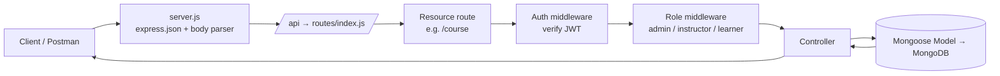
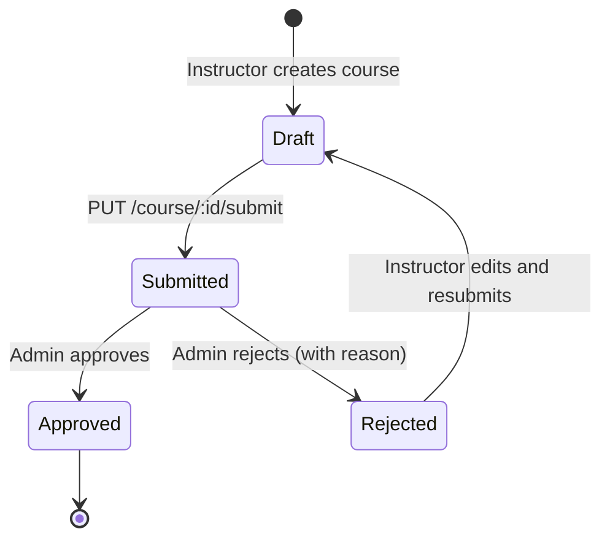

# 🚗 Driving School Management System API

A RESTful backend API for running an online driving school. Instructors create and publish driving courses, admins review and approve them, and learners enroll, pay, and track their progress — all secured with JWT authentication and role-based access control.

> **Note:** This is a learning/demo project. Payment is **simulated**; no real payment gateway is connected.

---

## 📑 Table of Contents

1. [Features](#-features)
2. [Tech Stack](#-tech-stack)
3. [User Roles](#-user-roles)
4. [Project Structure](#-project-structure)
5. [Architecture & Request Flow](#-architecture--request-flow)
6. [Getting Started](#-getting-started)
7. [Environment Variables](#-environment-variables)
8. [Authentication](#-authentication)
9. [Course Lifecycle](#-course-lifecycle)
10. [API Reference](#-api-reference)
11. [End-to-End Testing Walkthrough (Postman)](#-end-to-end-testing-walkthrough-postman)
12. [Error Handling](#-error-handling)
13. [Future Improvements](#-future-improvements)
14. [License](#-license)

---

## ✨ Features

- 🔐 **JWT authentication** with hashed passwords (bcrypt)
- 👥 **Three roles** — Admin, Instructor, Learner — each with their own permissions
- 🗂️ **Course categories** managed by admins (e.g. *Beginner Driving*, *Highway Driving*)
- 📚 **Course management** by instructors with a built-in **approval workflow** (draft → submitted → approved / rejected)
- 🧩 **Modules** inside each course, with ordering/reordering support
- 🎓 **Enrollment** for learners, including **progress tracking** (0–100%)
- 💳 **Simulated payments** for paid courses
- 🙍 **Profiles** for instructors and learners
- 🛡️ **Admin tools** to list users and activate/deactivate accounts

---

## 🛠 Tech Stack

| Layer            | Technology                  |
| ---------------- | --------------------------- |
| Runtime          | Node.js                     |
| Framework        | Express.js 4                |
| Database         | MongoDB                     |
| ODM              | Mongoose 8                  |
| Authentication   | JSON Web Tokens (`jsonwebtoken`) |
| Password hashing | `bcrypt`                    |
| Config           | `dotenv`                    |
| Body parsing     | `express.json()` + `body-parser` |
| Dev tooling      | `nodemon`                   |

---

## 👥 User Roles

| Role           | What they can do |
| -------------- | ---------------- |
| **Admin**      | Create categories, list all users, activate/deactivate users, approve or reject submitted courses |
| **Instructor** | Create courses, submit them for approval, manage modules, view their own courses, create an instructor profile |
| **Learner**    | Browse approved courses, enroll, pay for paid courses, update progress, create a learner profile |

**Example:**
- *Test Instructor* creates the course **"Basics of City Driving"** and submits it.
- *Admin* reviews it and approves it.
- *Rahul (learner)* enrolls, pays, and updates his progress to 25%.

---

## 📁 Project Structure

```
driving-school-management-system-api/
├── config/
│   └── db.js                 # MongoDB connection
├── controllers/              # Business logic for each resource
├── middleware/               # Auth (JWT) and role-check middleware
├── models/                   # Mongoose schemas
├── routes/
│   └── index.js              # Main router, mounts all resource routes
├── server.js                 # App entry point
├── package.json
├── API-TESTING.txt           # Quick Postman sequence
├── .env                      # Environment variables (not committed)
└── README.md
```

### What each folder does

| Folder / File | Responsibility | Example |
| ------------- | -------------- | ------- |
| `server.js` | Loads env, connects to DB, registers middleware and the `/api` router, starts the server | Starts on `http://localhost:3000` |
| `config/` | Database connection setup | Connects to `mongodb://127.0.0.1:27017/driving_school` |
| `routes/` | Maps URL + HTTP method to a controller function and attaches middleware | `POST /api/course` → course controller, only for instructors |
| `middleware/` | Runs before controllers: verifies the JWT token and checks the user's role | Blocks a learner from calling `POST /api/category` |
| `controllers/` | Reads the request, talks to the models, sends the response | Creating a course, approving a course, joining a course |
| `models/` | Mongoose schemas that define the data stored in MongoDB | User, Category, Course, Module, Enrollment, Payment, profiles |

---

## 🔄 Architecture & Request Flow

The project follows a simple, layered pattern:

```
server.js  →  routes/index.js  →  routes  →  controllers  →  models  →  MongoDB
```

### Request lifecycle



### Step-by-step example: an instructor creates a course

1. Client sends `POST /api/course` with header `Authorization: Bearer <token>` and a JSON body.
2. `server.js` parses the JSON body and forwards anything under `/api` to `routes/index.js`.
3. `routes/index.js` forwards `/course` requests to the course routes.
4. The **auth middleware** verifies the token and identifies the user.
5. The **role middleware** confirms the user is an `instructor`. A learner would get a rejection here.
6. The **course controller** validates the data and saves the course through the Course model.
7. The API responds with the created course.

---

## 🚀 Getting Started

### Prerequisites

- [Node.js](https://nodejs.org/) (v16 or higher recommended)
- [MongoDB](https://www.mongodb.com/try/download/community) running locally (or a MongoDB Atlas URI)
- [Postman](https://www.postman.com/) for testing (optional)

### Installation

```bash
# 1. Clone the repository
git clone https://github.com/<your-username>/driving-school-management-system-api.git

# 2. Go into the project folder
cd driving-school-management-system-api

# 3. Install dependencies
npm install

# 4. Create your environment file (see next section)
#    then make sure MongoDB is running

# 5. Start the server
npm run dev      # development (auto-restart with nodemon)
# or
npm start        # production
```

If everything works you will see:

```
server port started on http://localhost:3000
```

### Available scripts

| Command       | Description                         |
| ------------- | ----------------------------------- |
| `npm start`   | Runs `node server.js`               |
| `npm run dev` | Runs the server with `nodemon`      |

---

## 🔧 Environment Variables

Create a `.env` file in the project root:

```env
PORT=3000
DEV_DB_URL="mongodb://127.0.0.1:27017/driving_school"
JWT_SECRET="replace_with_a_long_random_secret"
```

| Variable     | Description                               | Example |
| ------------ | ----------------------------------------- | ------- |
| `PORT`       | Port the server listens on (default 3000) | `3000`  |
| `DEV_DB_URL` | MongoDB connection string                 | `mongodb://127.0.0.1:27017/driving_school` |
| `JWT_SECRET` | Secret key used to sign and verify tokens | a long random string |

> ⚠️ **Never commit your real `.env` file.** Add `.env` to `.gitignore` and use a strong, unique `JWT_SECRET`.

---

## 🔑 Authentication

The API uses **Bearer token** authentication.

1. Register with `POST /api/auth/registration`.
2. Log in with `POST /api/auth/login` and copy the token from the response.
3. Send the token on every protected request:

```
Authorization: Bearer YOUR_TOKEN
```

**Example registration body**

```json
{
  "name": "Test Instructor",
  "email": "instructor@test.com",
  "password": "123456",
  "Cpassword": "123456",
  "role": "instructor"
}
```

`Cpassword` is the confirm-password field and must match `password`. The `role` is one of `instructor` or `learner`; admin accounts are created with the seed script.

**Example login body**

```json
{
  "email": "instructor@test.com",
  "password": "123456"
}
```

---

## 🔁 Course Lifecycle

Every course passes through an approval workflow before learners can see it.



**Example:**
1. Instructor creates *"Beginner Driving 101"* → **draft**
2. Instructor calls `PUT /api/course/<id>/submit` → **submitted**
3. Admin calls `PUT /api/course/<id>/reject` with `{"reason":"Please update course details"}` → **rejected**
4. Instructor fixes the details and submits again → **submitted**
5. Admin calls `PUT /api/course/<id>/approve` → **approved** and visible to learners

---

## 📡 API Reference

**Base URL:** `http://localhost:3000/api`

### Auth

| Method | Endpoint             | Access | Description |
| ------ | -------------------- | ------ | ----------- |
| POST   | `/auth/registration` | Public | Create a new account |
| POST   | `/auth/login`        | Public | Log in and receive a JWT |

### Users (Admin)

| Method | Endpoint            | Access | Description |
| ------ | ------------------- | ------ | ----------- |
| GET    | `/user`             | Admin  | List all users |
| PUT    | `/user/:id/status`  | Admin  | Activate or deactivate a user |

```json
// PUT /api/user/:id/status
{ "status": "inactive" }
```

### Profiles

| Method | Endpoint             | Access     | Description |
| ------ | -------------------- | ---------- | ----------- |
| POST   | `/instructorProfile` | Instructor | Create an instructor profile |
| POST   | `/learnerProfile`    | Learner    | Create a learner profile |

### Categories

| Method | Endpoint    | Access | Description |
| ------ | ----------- | ------ | ----------- |
| POST   | `/category` | Admin  | Create a category |
| GET    | `/category` | Public / Authenticated | List all categories |

```json
// POST /api/category
{
  "name": "Beginner Driving",
  "description": "Basics"
}
```

### Courses

| Method | Endpoint               | Access     | Description |
| ------ | ---------------------- | ---------- | ----------- |
| POST   | `/course`              | Instructor | Create a course (needs a category ID) |
| GET    | `/course`              | Authenticated | List courses |
| GET    | `/course/my`           | Instructor | List the instructor's own courses |
| PUT    | `/course/:id/submit`   | Instructor | Submit a course for admin review |
| PUT    | `/course/:id/approve`  | Admin      | Approve a submitted course |
| PUT    | `/course/:id/reject`   | Admin      | Reject a course with a reason |

```json
// PUT /api/course/:id/reject
{ "reason": "Please update course details" }
```

### Modules

| Method | Endpoint                    | Access     | Description |
| ------ | --------------------------- | ---------- | ----------- |
| POST   | `/module`                   | Instructor | Add a module to a course |
| GET    | `/module/course/:courseId`  | Authenticated | List modules of a course |
| PUT    | `/module/:id`               | Instructor | Update a module or reorder it using `order` |
| DELETE | `/module/:id`               | Instructor | Delete a module |

**Example:** A course *"City Driving Basics"* can have modules ordered `1` *Traffic Signs*, `2` *Clutch Control*, `3` *Parking*. Updating *Parking* to `order: 2` reorders it.

### Enrollment

| Method | Endpoint                     | Access  | Description |
| ------ | ---------------------------- | ------- | ----------- |
| POST   | `/enrollment/join`           | Learner | Join a course |
| PUT    | `/enrollment/:id/progress`   | Learner | Update course progress |

```json
// POST /api/enrollment/join
{ "course": "COURSE_ID" }

// PUT /api/enrollment/ENROLLMENT_ID/progress
{ "progress": 50 }
```

### Payment (simulated)

| Method | Endpoint         | Access  | Description |
| ------ | ---------------- | ------- | ----------- |
| POST   | `/payment/make`  | Learner | Make a demo payment for a paid course |

```json
// POST /api/payment/make
{
  "course": "COURSE_ID",
  "status": "success"
}
```

---

## 🧪 End-to-End Testing Walkthrough (Postman)

Follow this sequence to test the whole system:

| #  | Action                       | Request |
| -- | ---------------------------- | ------- |
| 1  | Register an instructor       | `POST /api/auth/registration` |
| 2  | Log in as instructor         | `POST /api/auth/login` |
| 3  | Log in as admin              | Default admin: `admin@drivingschool.com` / `admin123` (created with the seed script) |
| 4  | Create a category (admin)    | `POST /api/category` → `{"name":"Beginner Driving","description":"Basics"}` |
| 5  | Create a course (instructor) | `POST /api/course` with the category ID and course fields |
| 6  | Submit the course            | `PUT /api/course/COURSE_ID/submit` |
| 7  | Approve the course (admin)   | `PUT /api/course/COURSE_ID/approve` |
| 8  | Register/login a learner and join | `POST /api/enrollment/join` → `{"course":"COURSE_ID"}` |
| 9  | Pay (for paid courses)       | `POST /api/payment/make` → `{"course":"COURSE_ID","status":"success"}` |
| 10 | Update progress              | `PUT /api/enrollment/ENROLLMENT_ID/progress` → `{"progress":25}` |

Remember to add `Authorization: Bearer YOUR_TOKEN` to every request after logging in, using the token that belongs to the role being tested.

> ⚠️ Change the default admin password immediately if you ever deploy this project.

---

## ⚠️ Error Handling

| Status | Meaning | Typical cause |
| ------ | ------- | ------------- |
| `400`  | Bad request | Missing fields, passwords don't match |
| `401`  | Unauthorized | Missing, invalid or expired token |
| `403`  | Forbidden | Your role isn't allowed (e.g. a learner creating a category) |
| `404`  | Not found | Invalid course, module or enrollment ID |
| `500`  | Server error | Unexpected error or database problem |

---

## 🔮 Future Improvements

- Integrate a real payment gateway (Razorpay / Stripe)
- Lesson booking and instructor availability scheduling
- Vehicle and license-test management
- Certificates on course completion
- Input validation with `Joi` or `express-validator`
- Rate limiting and Helmet for extra security
- Swagger / OpenAPI documentation
- Unit and integration tests

